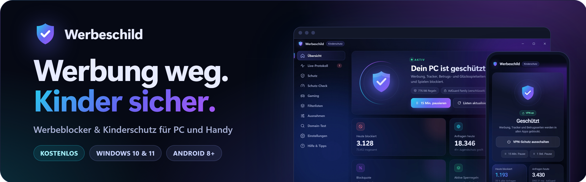
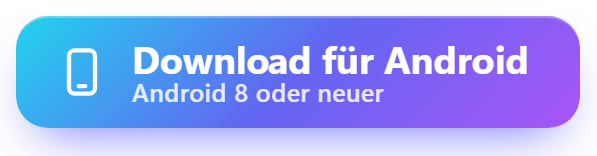
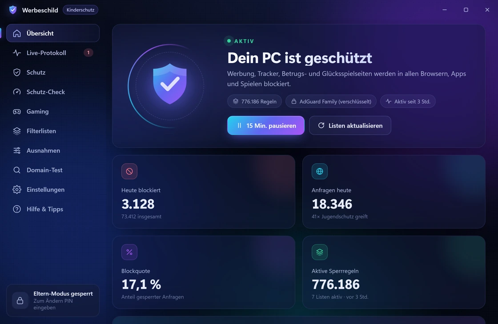
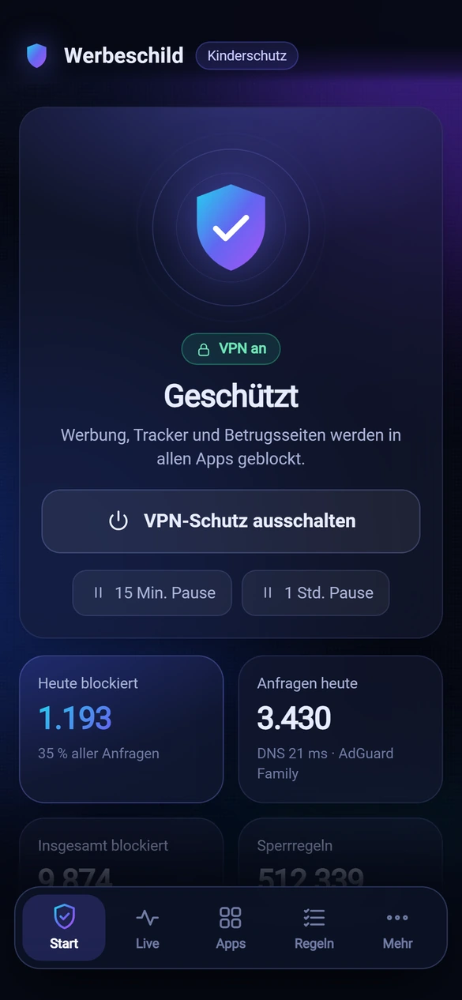
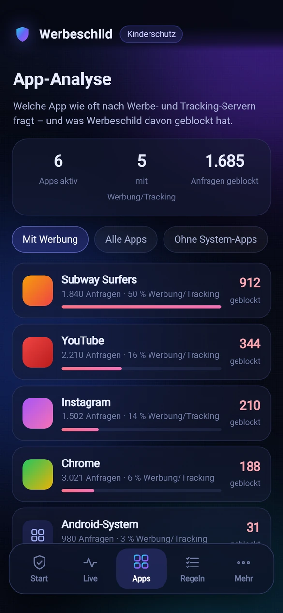

  

  
  
  

  
  
  

 

**Werbeschild** blockt Werbung, Tracker, Betrugs- und Glücksspielseiten auf dem ganzen PC und Handy – in jedem Browser, jeder App und jedem Spiel. Damit Kinder nicht aus Versehen auf Werbung klicken und etwas kaufen. Kostenlos, ohne Konto, ohne Werbung.

## ✨ Funktionen

<table>
  <tr>
    <td width="50%">🛡️ <b>Werbung &amp; Tracker weg</b> Systemweit – in allen Browsern, Apps und Spielen.</td>
    <td width="50%">👪 <b>Kinderschutz mit Eltern-PIN</b> Jugendfreie Suche, YouTube-Jugendschutz, Umgehungssperre.</td>
  </tr>
  <tr>
    <td>🚫 <b>Betrug &amp; Fake-Shops</b> Phishing, Abzocke und Glücksspiel werden gesperrt.</td>
    <td>🧱 <b>Sperrseite statt Fehler</b> (PC) Erklärt, warum eine Seite gesperrt ist – Eltern geben mit PIN frei.</td>
  </tr>
  <tr>
    <td>🎮 <b>Gaming-Modus</b> (PC) Höchstleistung, gedrosselte Downloads, VPN pausiert.</td>
    <td>🔒 <b>Privat &amp; sicher</b> Filter läuft auf dem Gerät, signierte automatische Updates.</td>
  </tr>
</table>

## 📸 So sieht es aus

  
  &nbsp;
  
  

Beispielansichten mit Demo-Zahlen

## ⬇️ Installieren

**Windows 10 & 11** – [Werbeschild-Setup.exe herunterladen](https://github.com/MHP3878/werbeschild/releases/latest/download/Werbeschild-Setup.exe)
1. Datei öffnen. Zeigt Windows „Der Computer wurde durch Windows geschützt“: **Weitere Informationen → Trotzdem ausführen** (der Installer ist noch nicht code-signiert).
2. Modus wählen: **Kinderschutz** mit Eltern-PIN oder **Standard** – fertig. Updates kommen danach automatisch.

**Android 8 oder neuer** – [Werbeschild-Android.apk herunterladen](https://github.com/MHP3878/werbeschild/releases/latest/download/Werbeschild-Android.apk)
1. Datei öffnen und „Unbekannte Apps installieren“ für den Browser erlauben (Google lässt systemweite Werbeblocker nicht in den Play Store).
2. Installieren, App öffnen, Modus wählen und die Anfrage für das lokale VPN bestätigen.

Ausführliche Anleitung und Antworten auf häufige Fragen: **[mhp3878.github.io/werbeschild](https://mhp3878.github.io/werbeschild/)**

## 🔐 Datenschutz

Werbeschild filtert auf deinem Gerät – kein Konto, keine Statistik an uns. Adressabfragen gehen **verschlüsselt** an einen Familien-DNS-Dienst (AdGuard DNS oder Cloudflare). Updates werden mit dem eigenen Werbeschild-Schlüssel **signiert**; veränderte oder fremde Dateien installiert Werbeschild nicht. Details in der [Datenschutzerklärung](https://mhp3878.github.io/werbeschild/datenschutz.html).

---

In diesem Projekt liegen die veröffentlichten Versionen (<a href="https://github.com/MHP3878/werbeschild/releases">Releases</a>) und die Webseite (<code>docs/</code>). Die Filterlisten stammen von unabhängigen Projekten (u. a. HaGeZi, AdGuard, StevenBlack) und stehen unter deren eigenen Lizenzen.
